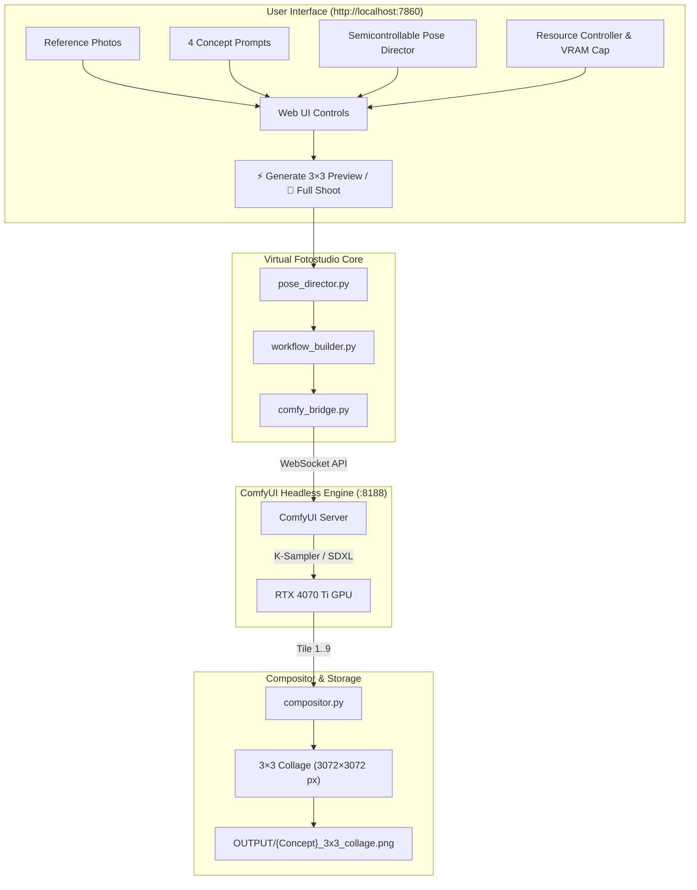

# 📸 Virtual AI Photostudio — Walkthrough & Operating Guide

Welcome to your local **Virtual AI Photostudio**! This document provides an end-to-end overview of the system architecture, how to run and stop the photostudio, how to customize poses and concepts, and how to reuse the pipeline for new models or subjects.

---

## 1. System Overview & Architecture

The photostudio runs completely locally on your **NVIDIA GeForce RTX 4070 Ti (12 GB VRAM)** using your existing ComfyUI engine and a dark editorial Streamlit interface at `http://localhost:7860`.



---

## 2. Directory Structure

```text
G:\VSCode\VirtualFotostudio\
├── app.py                  # Single-page Streamlit web application
├── pose_director.py        # Semicontrollable pose generator (Vibe + Chaos + framing pool)
├── workflow_builder.py     # Clean SDXL ComfyUI txt2img/img2img API workflow builder
├── comfy_bridge.py         # Headless WebSocket & HTTP API client for ComfyUI
├── compositor.py           # 3×3 3072×3072 collage assembler with subtle grid borders
├── start_photostudio.bat   # One-click launcher (ComfyUI engine + Web UI + opens browser)
├── stop_photostudio.bat    # One-click stopper (terminates processes & releases VRAM)
├── scripts\
│   └── download_models.py  # Helper script to download SDXL portrait checkpoints
├── Reference\              # Pre-loaded reference photos of your subject
└── OUTPUT\                 # Destination for final collages and individual shots
```

---

## 3. How to Launch & Stop

### Launching
Double-click **`start_photostudio.bat`** (or execute from PowerShell/cmd):
1. Verifies if ComfyUI headless engine is running on port `8188`; starts it minimized if offline.
2. Checks that Python dependencies (`streamlit`, `websocket-client`) are installed.
3. Launches the web UI with Below-Normal process priority (to keep your PC fast for other work).
4. Automatically opens `http://localhost:7860` in your default browser.

### Stopping
Double-click **`stop_photostudio.bat`**:
1. Cleanly shuts down the Streamlit server on port `7860`.
2. Cleanly terminates the ComfyUI engine on port `8188`.
3. Immediately releases all allocated GPU memory back to Windows.

---

## 4. Key Features & Controls

| Feature | Description |
| :--- | :--- |
| **1 · Reference Photos** | Automatically loads photos from `Reference/` or lets you upload new ones via drag & drop. |
| **2–5 · Photoshoot Concepts** | Pre-loaded with 4 curated concepts (*Golden Hour Botanical*, *Minimalist Studio*, *Urban Cyberpunk*, *Cozy Autumn*), all 100% user-editable. |
| **6 · Pose Director** | Select a **Vibe / Energy** preset (*Candid & Natural*, *Editorial High-Fashion*, *Cinematic Film*, *Playful & Expressive*, etc.), adjust the **Chaos slider** (from structured studio poses to wild candid moments), and input optional **Custom Keywords**. |
| **7 · Resource Controller** | Select **Quiet Background** (5 GB VRAM cap), **Balanced** (8 GB), or **Turbo** (11.5 GB) presets so you can keep working in other apps while generating in the background. |
| **⚡ Generate 3×3 Preview** | Generates a 9-tile photoshoot concept preview, updating the UI tile-by-tile, and compiles the final **3072×3072 px** collage. |
| **🔄 Per-Tile Re-roll** | Don't like one specific angle? Click `🔄 #3` to re-roll just that tile with a fresh seed without regenerating the full collage. |
| **🚀 Run Full Photoshoot** | Runs the photoshoot and saves both the 3072×3072 collage and all individual 1024×1024 shots to `OUTPUT/{ConceptName}/`. |

---

## 5. Reusing for Future Subjects / Models

To use this environment for a different person or model:
1. **Change the Reference Photos**: Clear `Reference/` and drop in new photos, or upload them via the web UI.
2. **Update the Subject Description**: In [pose_director.py](file:///G:/VSCode/VirtualFotostudio/pose_director.py#L125), adjust `SUBJECT_DESCRIPTION` to match your new subject's hair color, eye color, features, and style.
3. **Switch Checkpoints**: In the web UI dropdown, select any SDXL checkpoint installed in `%USERPROFILE%\Documents\ComfyUI\models\checkpoints\` (or the directory configured by `COMFY_BASE_DIR`).
