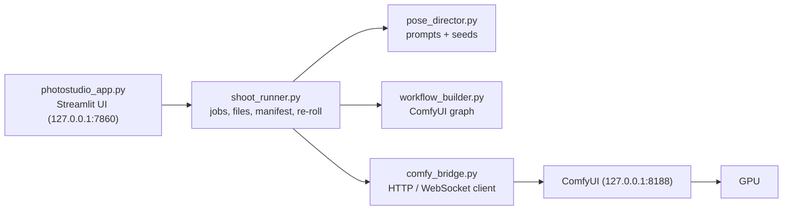

# Virtual AI Photostudio - Walkthrough

A local photobooth: you give it a reference photo, pick a concept, and ComfyUI renders new photos of that person (IP-Adapter FaceID Plus V2 on SDXL). Nothing is trained and nothing leaves your PC. For one-time installation see [README.md](README.md).

## How the pieces fit

| File | Role |
| --- | --- |
| `photostudio_app.py` | The web page only: widgets, preview grid, status messages. |
| `shoot_runner.py` | Runs a series of images, writes files and `shoot_manifest.json`, re-rolls single images. No Streamlit inside, so it can be tested alone. |
| `pose_director.py` | Concept templates, vibes, camera framings and the seed logic that turns your settings into one prompt per image. |
| `workflow_builder.py` | Builds the ComfyUI node graph (checkpoint, FaceID adapter, sampler). |
| `comfy_bridge.py` | Talks to ComfyUI: upload, queue, wait for results, readiness checks, VRAM release. |
| `scripts/download_models.py` | Downloads and size-validates the checkpoint, FaceID files, Plus Face adapter and CLIP Vision model. |
| `scripts/manage_services.py` | Tracks the ComfyUI and Streamlit processes started by the launcher so stop never kills an unrelated listener. |
| `start_photostudio.bat` / `stop_photostudio.bat` | Start or stop ComfyUI and the web UI. |
| `Reference/`, `OUTPUT/` | Your reference photos and everything generated (both git-ignored). |

## Start and stop

`start_photostudio.bat [quiet|balanced|turbo]` starts ComfyUI if needed, waits until it answers, then opens `http://127.0.0.1:7860`. The page is reachable from this PC only. `stop_photostudio.bat` stops only processes started by this launcher; already-running external services are left alone.

## Using the page

1. **Reference photos** - upload reference photos and pick one primary likeness reference. All are kept in `Reference/`; a different photo with the same file name never replaces an existing one. Only the selected photo is currently used for likeness.
2. **Concepts and direction** - each concept is an editable prompt (setting, lighting, wardrobe). The prompts never describe the person; identity comes only from the reference photo. *Vibe* chooses the mood of the poses, *Pose freedom* how much framings and actions are shuffled, *Pose guidance* adds your own keywords, and a fixed *Seed* makes a shoot repeatable (-1 = random).
3. **Quality and likeness** - *Identity strength* trades likeness against prompt freedom. *Performance mode* sets steps and preview size. Pick an SDXL checkpoint.
4. **Generate**
   - **3x3 prompt preview** - nine independent images, a quick way to judge a concept.
   - **Full Photoshoot** - the number of high-resolution images you choose. Each is rendered at SDXL's native size (896x1152 or 1152x896); with *Detail pass* ticked it is then enlarged 1.5x and refined by a second pass, giving 1344x1728 (or 1728x1344). This avoids the warped details that rendering very large in one pass causes, at the cost of time and VRAM.
   - **Batch Concepts** - the full shoot for every ticked concept.
   - **Re-roll** (below each preview image) - replaces just that image with a new seed *and* a new pose, keeping the same reference, concept and settings as the preview. It reloads models each time unless you untick *Auto-release ComfyUI VRAM*, so untick it for quick consecutive re-rolls.

Leave the page alone while a job runs: changing a setting restarts the script and interrupts the job.

## What is saved

Every job creates `OUTPUT/<timestamp>_<concept>/` containing the PNG files (`NN_<seed>.png`, with a numeric suffix if that name already exists) and `shoot_manifest.json` with the prompt, seed and settings of each image, including the base size, final output size and detail-pass settings. The manifest is updated after each image and includes job status and per-image failures, so interrupted jobs retain a useful record. A re-roll adds a collision-safe new file, updates the manifest and lists the replaced image under `superseded`; nothing is deleted.

## When something is wrong

| What you see | Meaning |
| --- | --- |
| "Identity workflow not ready: ..." | A FaceID node or model file is missing. The message names it; install it (see README) and restart ComfyUI. |
| "Image N failed: ..." | ComfyUI's own error for that image, shown immediately (for example no face found in the reference). The job continues with the next image. |
| ComfyUI shows Offline | ComfyUI is still starting or the launcher could not find it. Check `COMFY_BASE_DIR` / `COMFY_MAIN`, then refresh. |

## Using it for a different person

Just upload their photos. There is no subject description to edit. Wardrobe in the default concepts (dresses, gowns, blazers) is ordinary prompt text, so adjust it in the concept boxes if it does not suit the new subject.
